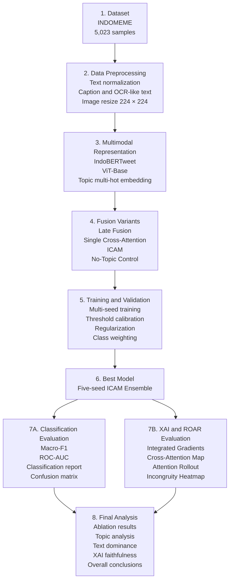
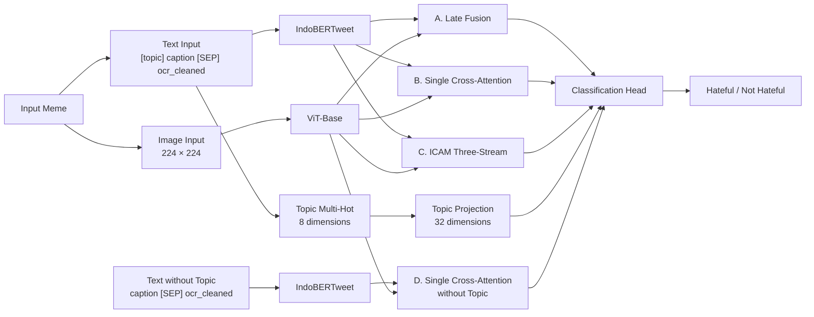
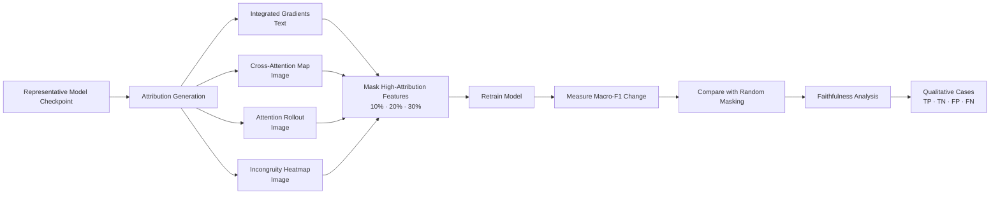

<div align="center">

# IndoMeme-XAI

### A Controlled Study of Multimodal Fusion and Explainable AI Faithfulness for Indonesian Hateful Meme Detection

[](https://www.python.org/)
[](https://pytorch.org/)
[](https://huggingface.co/datasets/aiatums/INDOMEME)

[](LICENSE)

</div>

## Overview

**IndoMeme-XAI** is a controlled experimental study of multimodal fusion, topic dependence, and Explainable AI faithfulness for Indonesian hateful meme detection.

The study fine-tunes **IndoBERTweet** and **Vision Transformer** encoders on 5,023 INDOMEME samples. It compares late fusion, single cross-attention, Incongruity-Aware Cross-Modal Attention, and a topic-ablated control.

Beyond classification performance, the project audits whether the model relies on topic-label correlations, whether textual information dominates its decisions, and whether post-hoc explanations are faithful to model behavior.

## Main Results

| Variant | Fusion Mechanism | Topic | Macro-F1 | Hateful F1 | Hateful Recall | ROC-AUC | Threshold |
|:--|:--|:--:|--:|--:|--:|--:|--:|
| A | Late Fusion | Yes | 0.7912 ± 0.001 | 0.728 | 0.736 | 0.883 | 0.49 |
| B | Single Cross-Attention | Yes | 0.7814 ± 0.005 | 0.713 | 0.709 | 0.877 | 0.50 |
| **C** | **ICAM Three-Stream** | **Yes** | **0.7946 ± 0.004** | **0.726** | **0.699** | **0.884** | **0.55** |
| D | Single Cross-Attention without Topic | No | 0.7456 ± 0.004 | 0.654 | 0.605 | 0.833 | 0.51 |
| **C + Ensemble** | **Five-seed ICAM Ensemble** | **Yes** | **0.8076** | **0.741** | **0.700** | **0.8875** | **0.57** |

The five-seed ICAM ensemble produced the strongest final result with a **Macro-F1 of 0.8076** and a **ROC-AUC of 0.8875**.

## Key Findings

**Fusion complexity**

The main fusion variants produced relatively close results. ICAM achieved the highest single-model Macro-F1, but only slightly outperformed the late-fusion baseline.

**Topic dependence**

The topic-ablated control obtained a Macro-F1 of 0.7456, reported as a 4.9 percentage-point decrease relative to ICAM. This indicates strong topic dependence and potential shortcut learning through topic-label correlations.

**Text dominance**

ROAR evaluation showed that masking high-attribution text features produced more consistent performance degradation than random text masking.

**Visual explanation faithfulness**

Cross-Attention Map, Attention Rollout, and Incongruity Heatmap remained close to the random image-masking baseline. These methods are therefore interpreted as diagnostic visualizations rather than direct evidence of the features determining model decisions.

## Research Workflow



## Model Architecture



ICAM combines three information streams:

| Stream | Function |
|:--|:--|
| Text-to-image attention | Allows text representations to attend to relevant visual patches |
| Image-to-text attention | Allows visual representations to attend to relevant text tokens |
| Incongruity stream | Models relative mismatch using cosine-similarity-based incongruity scores |
| Learned gating | Combines cross-attention and incongruity representations |

## Dataset

The project uses the [INDOMEME](https://huggingface.co/datasets/aiatums/INDOMEME) dataset.

The official training split contains 4,018 samples. This study divides it into 3,415 training samples and 603 internal validation samples while preserving the official test set for final evaluation.

| Split | Hateful | Not Hateful | Total | Hateful Rate |
|:--|--:|--:|--:|--:|
| Train | 1,173 | 2,242 | 3,415 | 34.3% |
| Validation | 213 | 390 | 603 | 35.3% |
| Test | 347 | 658 | 1,005 | 34.5% |
| **Total** | **1,733** | **3,290** | **5,023** | **34.5%** |

### Dataset Inputs

| Column | Description | Usage |
|:--|:--|:--|
| `image` | Meme image | Visual input |
| `image_path` | Original image filename | Sample identification |
| `hate_final` | Hateful or not hateful label | Main classification target |
| `appropriate_final` | Content appropriateness label | Not used as the main target |
| `topic` | English topic annotation | Topic feature and ablation analysis |
| `topic_id` | Indonesian topic annotation | Topic interpretation |
| `ocr` | OCR-like representation generated using Qwen2-VL-2B | Text input |
| `caption` | Formal description generated using Gemini 2.5 Flash | Text input |

The final text representation follows this format:

```text
[topic] caption [SEP] ocr_cleaned
```

Because captions transfer part of the visual content into the textual channel, text dominance in this study may reflect embedded meme text, OCR-like text, dataset-provided captions, and topic tokens.

## Fusion Variants

| Variant | Mechanism | Topic Input | Evaluation Purpose |
|:--|:--|:--:|:--|
| A | Late Fusion | Yes | Simple multimodal baseline |
| B | Single Cross-Attention | Yes | One-way text-image interaction |
| C | ICAM Three-Stream | Yes | Bidirectional fusion and incongruity modeling |
| D | Single Cross-Attention without Topic | No | Topic-dependence control |

## Experimental Setup

| Component | Configuration |
|:--|:--|
| Text encoder | IndoBERTweet |
| Image encoder | ViT-Base |
| Optimizer | AdamW |
| Weight decay | 0.01 |
| Encoder learning rate | 1e-5 |
| Fusion learning rate | 3e-5 |
| Classification-head learning rate | 5e-5 |
| Scheduler | 10% warmup with learning-rate scheduling |
| Effective batch size | 64 using 32 × 2 gradient accumulation |
| Main objective | Focal Loss and Supervised Contrastive Loss |
| Label smoothing | 0.1 |
| Regularization | Dropout and R-Drop |
| Gradient clipping | 1.0 |
| Early stopping | Patience of 5 |
| Threshold calibration | Validation grid search from 0.40 to 0.65 |
| Final ensemble | Average softmax probabilities from five seeds |

Macro-F1 is used as the primary evaluation metric because the dataset is class-imbalanced. Supporting metrics include ROC-AUC, Weighted-F1, accuracy, precision, recall, and per-class F1-score.

## XAI and Faithfulness Evaluation



### Attribution Methods

| Method | Domain | Purpose | ROAR Interpretation |
|:--|:--|:--|:--|
| Integrated Gradients | Text | Measures token contribution | More consistent degradation than random masking |
| Cross-Attention Map | Image | Visualizes text-to-image interaction | Remained close to random baseline |
| Attention Rollout | Image | Traces attention flow through ViT | Remained close to random baseline |
| Incongruity Heatmap | Image | Visualizes cross-modal mismatch signals | Diagnostic, but remained close to random baseline |

### ROAR Results

The values below represent changes in Macro-F1 after masking high-attribution features and retraining the model.

| Method | Domain | 10% | 20% | 30% |
|:--|:--|--:|--:|--:|
| Integrated Gradients | Text | -0.0202 | -0.0354 | -0.0381 |
| Random baseline | Text | -0.0070 | -0.0221 | -0.0282 |
| Cross-Attention Map | Image | +0.0029 | -0.0014 | +0.0043 |
| Attention Rollout | Image | -0.0012 | +0.0033 | +0.0009 |
| Incongruity Heatmap | Image | +0.0017 | -0.0016 | +0.0036 |
| Random baseline | Image | +0.0071 | +0.0008 | -0.0007 |

## Reproducibility

The ablation study uses three fixed seeds:

```text
42, 123, 2024
```

The final ICAM ensemble uses five seeds:

```text
42, 123, 2024, 7, 999
```

The validation set is used for model selection and threshold calibration. The official test set remains unchanged for final evaluation.

## Getting Started

```bash
git clone https://github.com/<YOUR_USERNAME>/IndoMeme-XAI.git
cd IndoMeme-XAI

python -m venv .venv
```

Linux or macOS:

```bash
source .venv/bin/activate
pip install -r requirements.txt
```

Windows PowerShell:

```powershell
.venv\Scripts\Activate.ps1
pip install -r requirements.txt
```

## Research Scope

The reported findings are specific to the INDOMEME dataset, the evaluated fusion configurations, and the selected attribution methods.

ICAM is positioned as a fusion mechanism evaluated in the context of this dataset rather than as a universal architecture for all multimodal tasks.

The results also do not establish topic leakage as definitive causal evidence. Instead, the topic ablation, per-topic label distribution, and Integrated Gradients analysis provide strong indications that the model may exploit topic-label correlations as shortcut learning.

## Future Work

Future research can extend this study through topic-controlled data splits, text-only and image-only baselines, OCR-only and caption-only ablations, topic-only experiments, stronger vision-language models, and human evaluation of XAI usefulness in content moderation.

## Acknowledgments

[INDOMEME](https://huggingface.co/datasets/aiatums/INDOMEME) by Pamungkas et al.

[IndoBERTweet](https://huggingface.co/indolem/indobertweet-base-uncased) by Koto et al.

[Captum](https://captum.ai/) for Integrated Gradients implementation.

[Kaggle](https://www.kaggle.com/) for computational resources.

## License

The source code is distributed under the license specified in [LICENSE](LICENSE).

The accompanying manuscript is licensed under the Creative Commons Attribution 4.0 International License.
