# Multimodal Fusion Architecture

Diagram berikut merepresentasikan alur model multimodal untuk klasifikasi **hateful / not hateful**. Model menerima teks, gambar, dan vektor topik, lalu membandingkan empat varian fusion: **Late Fusion**, **Single Cross-Attention**, **ICAM**, dan **Without Topic**.

```mermaid
flowchart LR
    %% ================================================================
    %% INPUTS
    %% ================================================================
    subgraph INPUTS["INPUTS"]
        direction TB
        TEXT_IN["Text input<br/><small>‘[topic] caption [SEP]<br/>OCR-like text’</small>"]
        IMAGE_IN["Image input<br/><small>224 × 224 image</small>"]
        TOPIC_IN["Topic vector<br/><small>8-dim multi-hot</small>"]
        TEXT_IN ~~~ IMAGE_IN ~~~ TOPIC_IN
    end

    %% ================================================================
    %% ENCODERS
    %% ================================================================
    subgraph ENCODERS["ENCODERS"]
        direction TB
        TEXT_ENCODER["Text Encoder<br/><b>IndoBERTweet</b>"]
        IMAGE_ENCODER["Image Encoder<br/><b>ViT-B/16</b>"]
        TOPIC_PROJ["Topic Projection<br/><b>Linear 8 → 32</b>"]
        TEXT_ENCODER ~~~ IMAGE_ENCODER ~~~ TOPIC_PROJ
    end

    %% ================================================================
    %% MULTIMODAL FUSION VARIANTS
    %% ================================================================
    subgraph FUSION["MULTIMODAL FUSION VARIANTS"]
        direction TB

        subgraph VARIANT_A["A. Late Fusion"]
            direction LR
            A_TEXT["Text CLS<br/>(768)"]
            A_IMAGE["Image CLS<br/>(768)"]
            A_CONCAT["Concat<br/><b>1536</b>"]
            A_LINEAR["Linear<br/><b>1536 → 768</b>"]
            A_FUSION["Fusion rep<br/><b>768</b>"]

            A_TEXT --> A_CONCAT
            A_IMAGE --> A_CONCAT
            A_CONCAT --> A_LINEAR --> A_FUSION
        end

        subgraph VARIANT_B["B. Single Cross-Attention"]
            direction LR
            B_TEXT["Text CLS<br/>(768)"]
            B_PATCHES["Image patches<br/><b>196 × 768</b>"]
            B_CROSS["Cross-Attended<br/>image rep: 768"]
            B_CONCAT["Concat with Text CLS<br/><b>1536</b>"]
            B_LINEAR["Linear<br/><b>1536 → 768</b>"]
            B_FUSION["Fusion rep<br/><b>768</b>"]

            B_TEXT -->|queries| B_PATCHES
            B_PATCHES --> B_CROSS
            B_TEXT --> B_CONCAT
            B_CROSS --> B_CONCAT
            B_CONCAT --> B_LINEAR --> B_FUSION
        end

        subgraph VARIANT_C["C. ICAM"]
            direction LR

            C_TEXT["Text CLS<br/>(768)"]
            C_IMAGE["Image CLS<br/>(768)"]

            C_T2I["Text-to-Image<br/>Cross-Attention"]
            C_I2T["Image-to-Text<br/>Cross-Attention"]
            C_ZT2I["Z<sub>T2I</sub><br/>(768)"]
            C_ZI2T["Z<sub>I2T</sub><br/>(768)"]

            C_CONCAT["Concat<br/><b>1536</b>"]
            C_LINEAR["Linear<br/><b>1536 → 768</b>"]
            C_ZCA["Z<sub>CA</sub><br/>(768)"]

            C_SIM["Token–Patch<br/>Cosine Similarity<br/><small>L × 196</small>"]
            C_MISMATCH["Patch Mismatch<br/>Weighting"]
            C_ZINC["Z<sub>INC</sub><br/>(768)"]

            C_GATE["Feature-wise<br/>Gate"]
            C_MULT(("⊗<br/><small>FW</small>"))
            C_ZICAM["Z<sub>ICAM</sub><br/>(768)"]

            C_TEXT --> C_T2I --> C_ZT2I --> C_CONCAT
            C_IMAGE --> C_I2T --> C_ZI2T --> C_CONCAT
            C_CONCAT --> C_LINEAR --> C_ZCA --> C_MULT

            C_TEXT --> C_SIM
            C_IMAGE --> C_SIM
            C_SIM --> C_MISMATCH --> C_ZINC --> C_MULT
            C_GATE -.-> C_MULT
            C_MULT --> C_ZICAM
        end

        subgraph VARIANT_D["D. Without Topic — no topic token / no topic embedding"]
            direction LR
            D_TEXT["Text CLS<br/>(768)"]
            D_PATCHES["Image patches<br/><b>196 × 768</b>"]
            D_CROSS["Cross-Attended<br/>image rep: 768"]
            D_CONCAT["Concat with Text CLS<br/><b>1536</b>"]
            D_LINEAR["Linear<br/><b>1536 → 768</b>"]
            D_FUSION["Fusion rep<br/><b>768</b>"]

            D_TEXT -->|queries| D_PATCHES
            D_PATCHES --> D_CROSS
            D_TEXT --> D_CONCAT
            D_CROSS --> D_CONCAT
            D_CONCAT --> D_LINEAR --> D_FUSION
        end

        VARIANT_A ~~~ VARIANT_B ~~~ VARIANT_C ~~~ VARIANT_D
    end

    %% ================================================================
    %% CLASSIFICATION HEADS
    %% ================================================================
    subgraph HEADS["CLASSIFICATION HEAD"]
        direction TB

        subgraph HEAD_ABC["A / B / C"]
            direction TB
            H_FUSION["Fusion rep<br/><b>768</b>"]
            H_TOPIC["Topic emb<br/><b>32</b>"]
            H_CONCAT["Concat<br/><b>800</b>"]
            H_MLP["MLP<br/><b>800 → 256 → 2</b>"]
            H_SOFTMAX["Softmax"]
            H_OUTPUT(["hateful /<br/>not hateful"])

            H_FUSION --> H_CONCAT
            H_TOPIC --> H_CONCAT
            H_CONCAT --> H_MLP --> H_SOFTMAX --> H_OUTPUT
        end

        subgraph HEAD_D["D. Without Topic"]
            direction TB
            HD_FUSION["Fusion rep<br/><b>768</b>"]
            HD_MLP["MLP<br/><b>768 → 256 → 2</b>"]
            HD_SOFTMAX["Softmax"]
            HD_OUTPUT(["hateful /<br/>not hateful"])

            HD_FUSION --> HD_MLP --> HD_SOFTMAX --> HD_OUTPUT
        end


        HEAD_ABC ~~~ HEAD_D
    end

    %% ================================================================
    %% MAIN STAGE FLOW
    %% ================================================================
    INPUTS -->|"text · image · topic"| ENCODERS
    ENCODERS -->|"Text CLS / tokens · Image CLS / patches"| FUSION
    FUSION -->|"A/B/C: fusion 768 + topic 32<br/>D: fusion 768 only"| HEADS

    %% ================================================================
    %% COLOR SYSTEM
    %% ================================================================
    classDef textNode fill:#EFF6FF,stroke:#2563EB,color:#111827,stroke-width:1.5px;
    classDef imageNode fill:#F0FDF4,stroke:#65A30D,color:#111827,stroke-width:1.5px;
    classDef topicNode fill:#FFF7ED,stroke:#F97316,color:#111827,stroke-width:1.5px;
    classDef attentionNode fill:#FFFBEB,stroke:#F59E0B,color:#111827,stroke-width:1.5px;
    classDef inconsistencyNode fill:#FAF5FF,stroke:#9333EA,color:#111827,stroke-width:1.5px;
    classDef fusionNode fill:#EFF6FF,stroke:#3B82F6,color:#0F3D91,stroke-width:1.5px;
    classDef processNode fill:#FFFFFF,stroke:#6B7280,color:#111827,stroke-width:1.2px;
    classDef outputNode fill:#FFFFFF,stroke:#111827,color:#111827,stroke-width:1.4px;
    classDef gateNode fill:#FFFFFF,stroke:#111827,color:#111827,stroke-dasharray:5 4;

    class TEXT_IN,TEXT_ENCODER,A_TEXT,B_TEXT,C_TEXT,D_TEXT textNode;
    class IMAGE_IN,IMAGE_ENCODER,A_IMAGE,B_PATCHES,C_IMAGE,D_PATCHES imageNode;
    class TOPIC_IN,TOPIC_PROJ,H_TOPIC topicNode;
    class C_T2I,C_I2T attentionNode;
    class C_SIM,C_MISMATCH,C_ZINC inconsistencyNode;
    class A_FUSION,B_FUSION,C_ZT2I,C_ZI2T,C_ZCA,C_ZICAM,D_FUSION,H_FUSION,HD_FUSION fusionNode;
    class A_CONCAT,A_LINEAR,B_CROSS,B_CONCAT,B_LINEAR,C_CONCAT,C_LINEAR,D_CROSS,D_CONCAT,D_LINEAR,H_CONCAT,H_MLP,H_SOFTMAX,HD_MLP,HD_SOFTMAX processNode;
    class H_OUTPUT,HD_OUTPUT outputNode;
    class C_GATE gateNode;

    style INPUTS fill:#FFFFFF,stroke:#D1D5DB,stroke-width:1px
    style ENCODERS fill:#FFFFFF,stroke:#D1D5DB,stroke-width:1px
    style FUSION fill:#FFFFFF,stroke:#D1D5DB,stroke-width:1px
    style HEADS fill:#FFFFFF,stroke:#D1D5DB,stroke-width:1px
    style VARIANT_A fill:#FFFFFF,stroke:#2563EB,stroke-width:1.4px
    style VARIANT_B fill:#FFFFFF,stroke:#2563EB,stroke-width:1.4px
    style VARIANT_C fill:#FFFFFF,stroke:#2563EB,stroke-width:1.4px
    style VARIANT_D fill:#FFFFFF,stroke:#2563EB,stroke-width:1.4px
    style HEAD_ABC fill:#FFFFFF,stroke:#2563EB,stroke-width:1.4px
    style HEAD_D fill:#FFFFFF,stroke:#2563EB,stroke-width:1.4px
```

## Cara membaca alurnya

1. **Input dan encoding**
   - Teks diproses oleh **IndoBERTweet** menjadi token teks dan `Text CLS` berdimensi 768.
   - Gambar berukuran 224 × 224 diproses oleh **ViT-B/16** menjadi 196 patch token dan `Image CLS` berdimensi 768.
   - Vektor topik multi-hot berdimensi 8 diproyeksikan menjadi `Topic embedding` berdimensi 32.

2. **Pilih satu varian fusion**
   - **A — Late Fusion:** `Text CLS` dan `Image CLS` langsung digabungkan, lalu diproyeksikan menjadi representasi fusion 768.
   - **B — Single Cross-Attention:** `Text CLS` menjadi query terhadap image patches. Hasil cross-attention digabungkan kembali dengan `Text CLS`.
   - **C — ICAM:** dua arah cross-attention menghasilkan representasi lintas modalitas. Cabang lain menghitung ketidaksesuaian token–patch. Keduanya digabungkan melalui feature-wise gate menjadi `Z_ICAM` berdimensi 768.
   - **D — Without Topic:** memakai alur cross-attention seperti varian B, tetapi tidak menggunakan topic token maupun topic embedding.

3. **Classification head**
   - Untuk **A/B/C**, representasi fusion 768 digabungkan dengan topic embedding 32 sehingga menjadi vektor 800. Vektor ini masuk ke `MLP 800 → 256 → 2`, lalu `Softmax` menghasilkan kelas **hateful** atau **not hateful**.
   - Untuk **D**, representasi fusion 768 langsung masuk ke `MLP 768 → 256 → 2` tanpa topic embedding.

> **Catatan:** A, B, dan C adalah varian eksperimen alternatif. Pada satu eksperimen, hanya satu keluaran fusion yang diteruskan ke classification head A/B/C. Varian D digunakan sebagai ablation untuk mengukur pengaruh informasi topik.
